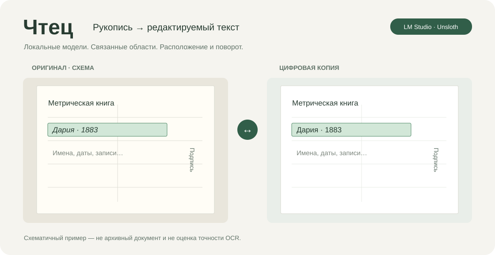

<div align="center">

# Чтец
### Рукопись → редактируемый текст

Локальное настольное приложение для оцифровки рукописных документов, фотографий и сканов.


[Возможности](#возможности) · [Установка](#установка) · [Первый документ](#первый-документ) · [Архитектура](docs/ARCHITECTURE.md)

</div>



**Сверяйте текст с оригиналом, уточняйте отдельные участки и сохраняйте результат вместе с разметкой.**
Чтец подключается к локальным моделям через **LM Studio** или **Unsloth**.
Документы отправляются на loopback-адрес этого компьютера; облачный OCR для работы приложения не требуется.

> **Статус: экспериментальная версия.** Качество распознавания зависит от модели,
> почерка и снимка. Имена, даты, числа и предложенные координаты необходимо проверять.
> Схема выше иллюстрирует интерфейс и не служит оценкой точности OCR.

## Возможности

| | Что умеет Чтец |
|---|---|
| **Импорт** | Фотографии и сканы, PDF, многостраничный TIFF, сохранённые проекты |
| **Локальные модели** | Отдельные профили LM Studio / Unsloth, запуск сервера и загрузка установленной модели |
| **Сверка** | Оригинал рядом с транскрипцией, масштабирование колесом и перемещение страницы |
| **Связанные области** | Выбор блока на фотографии подсвечивает его в цифровой копии — и наоборот |
| **Расположение** | Координаты и поворот блоков, в том числе вертикальных подписей |
| **Редактирование** | Ручная правка, меню копирования/вставки/удаления, общая история отмены |
| **Уточнение** | Повторное чтение увеличенного фрагмента и предложения правок от LLM |
| **Экспорт** | JSON-проект, пространственные PDF/HTML, линейные TXT/Markdown/DOCX |
| **Расширения** | Дополнительные импортёры и экспортёры через Python entry points |

Расположение восстанавливается **на уровне блоков** печатным шрифтом.
Приложение не имитирует почерк и не обещает посимвольных координат.

## Установка

Основная проверенная платформа — **Windows**. Нужны **Python 3.11+** и заранее
установленная локальная vision-модель. Требования к RAM/VRAM определяются моделью.

```powershell
git clone https://github.com/AlexBugalter/chtec.git
cd chtec
.\install.bat
.\start.bat
```

Или установите окружение вручную:

```powershell
py -3 -m venv .venv
.\.venv\Scripts\python.exe -m pip install -e ".[dev]"
.\.venv\Scripts\python.exe -m chtec
```

Для установки библиотек нужен интернет. Веса моделей в репозиторий не включены;
выберите и загрузите подходящую модель заранее средствами её локального сервера.

## Первый документ

1. Выберите **LM Studio** или **Unsloth** и откройте **Локальная модель**.
2. Укажите установленную модель. Для Unsloth выберите локальный **GGUF** с совместимым `mmproj`.
3. Нажмите **Активировать: запустить и загрузить**.
4. Добавьте фотографию или PDF и нажмите **Распознать страницу**.
5. Проверьте текст, внесите правки и откройте **Предпросмотр и сохранение**.

Для пространственной копии используйте **Распознать с расположением**.
Модель предложит текстовые блоки, координаты и углы. Сверьте предложение перед
применением, затем откройте вкладку **Как в оригинале**.

### Работа с участками

- Щелчок по блоку связывает выделение на оригинале и цифровой странице.
- Двойной щелчок или правая кнопка → **Редактировать** открывает текст и угол блока.
- **Уточнить выбранный блок** повторно читает его увеличенный фрагмент.
- Для старого текста без координат выделите слова и область изображения,
  затем нажмите **Привязать выделенный текст к участку**. Остаток текста сохраняется.
- **Перепривязать** меняет область блока; меню позволяет подтвердить геометрию
  и настроить порядок чтения. Пунктир обозначает непроверенную привязку.

### LM Studio и Unsloth

| | LM Studio | Unsloth |
|---|---|---|
| Типовой управляемый API | `http://127.0.0.1:1234/v1` | `http://127.0.0.1:8890/v1` |
| Выбор модели | Ключ установленной модели | Локальный GGUF |
| Автозапуск | Приложение и официальный `lms` | Официальный `unsloth run --api-only` |

Порты профилей должны различаться. При переключении Чтец освобождает собственную
предыдущую модель; модели, загруженные пользователем в других окнах, не выгружает.
Пути к CLI и приложению можно изменить в настройках. Веса автоматически не скачиваются.

API-ключи сессии Чтец не записывает в свой JSON настроек. Unsloth может хранить
свой служебный ключ собственными средствами. Для управляемого запуска отключены
инструменты агента и Cloudflare; адреса API ограничены loopback.

### Что сохраняется

| Формат | Назначение |
|---|---|
| **JSON** | Рабочий проект: изображения, текст, координаты, углы и история |
| **PDF / HTML** | Пространственная копия размеченных блоков |
| **TXT / Markdown / DOCX** | Линейная транскрипция |

Непривязанный текст не теряется: он сохраняется отдельно от пространственных блоков.
Старые JSON-проекты версии 1 читаются; новые используют версию 2.

## Остановка

`stop.bat` запрашивает штатное закрытие. Во время обработки доступна кнопка
**Остановить**; ожидание текущего запроса ограничено тайм-аутом.

`stop.bat /force` предназначен для зависшего приложения и завершает его
с потерей несохранённых изменений. Сохраняйте важные правки в JSON-проект.

## Разработка

В проекте используются ООП, стратегии форматов, отдельный слой локальных моделей
и фоновые Qt workers. Состояние документа отделено от интерфейса.

```powershell
.\.venv\Scripts\python.exe -m pytest -q
.\.venv\Scripts\python.exe -m ruff check chtec tests
```

В локальной проверке версии **0.4.0 прошли 122 теста**. Это проверки поведения
приложения, а не измерение точности чтения рукописи. Тестам не нужна загруженная LLM.

- [Подробное руководство](docs/USAGE.md)
- [Архитектура и поток данных](docs/ARCHITECTURE.md)
- [Как участвовать в разработке](CONTRIBUTING.md)
- [Пример плагина CSV](examples/csv_plugin/)

В публикацию входят исходники, тесты и синтетические примеры. Личные сканы,
проекты, результаты OCR, окружение Python и локальные настройки не публикуются.

---

**English:** Chtec is a Python desktop app for local handwritten-document transcription
with LM Studio / Unsloth, synchronized source and text regions, rotated text blocks,
manual editing, reviewable LLM suggestions, and spatial PDF/HTML export.
