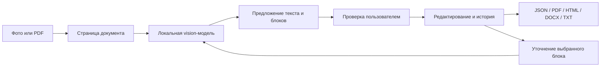

# Архитектура

Чтец разделяет документ, локальные модели, форматы файлов и интерфейс Qt.
Длительные операции выполняются через `Worker` в `QThread`; изменения интерфейса
и применение результатов происходят в потоке Qt.

| Модуль | Ответственность |
|---|---|
| `chtec/domain.py` | Страница, документ, история текста и разметки |
| `chtec/layout.py` | Блоки с ID, координатами, углом и проверка структуры |
| `chtec/layout_recognition.py` | Предложение разметки и повторное чтение блока |
| `chtec/regions.py` | Фрагменты исходного изображения или страницы PDF |
| `chtec/llm.py` | Запросы к локальному OpenAI-compatible API |
| `chtec/backends/` | Независимые профили, запуск и освобождение собственных моделей |
| `chtec/formats/` | Стратегии импорта/экспорта и реестр расширений |
| `chtec/spatial_export.py` | Геометрия текста в SVG/HTML и PDF |
| `chtec/ui/` | Холсты, редакторы, предложения правок, состояние окна |
| `examples/csv_plugin/` | Минимальный устанавливаемый экспортёр CSV |

## Поток обработки

## Инварианты

- Совпадающие слова связываются с изображением по ID блока, а не поиском строки.
- Текстовая правка не подтверждает автоматически координаты модели.
- При ручной привязке непривязанный остаток сохраняется отдельно.
- Отмена восстанавливает текст, области и повороты вместе.
- Предложения модели применяются после просмотра; повреждённый или обрезанный
  ответ не заменяет текущий текст.
- Источники не перезаписываются при экспорте. Проекты JSONv1 читаются; JSONv2
  сохраняет пространственные блоки и историю.
- API-ключи сессии исключаются из файла настроек; API допускает только loopback.
- При переключении систем освобождаются процессы/модели, которыми владеет Чтец.
  Произвольные чужие процессы приложение не завершает.

## Расширения

Новый формат реализует `Importer` или `Exporter` и регистрируется в `FormatRegistry`.
Установленный Python-пакет может предоставить функцию `register(registry)` через
entry point группы `chtec.formats`. Пример и команды установки — в
[руководстве](USAGE.md).

## Границы

Свободная транскрипция не содержит координат сама по себе. Старым результатам
нужны ручная привязка или повторное распознавание с разметкой. Пространственная
копия воспроизводит блоки печатным шрифтом, а не почерк. Геометрия из ответа LLM
считается предложением, которое следует сверить с оригиналом.
