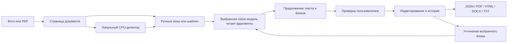

# Архитектура

Чтец разделяет документ, поставщиков моделей, форматы файлов и интерфейс Qt.
Длительные операции выполняются через `Worker` в `QThread`; изменения интерфейса
и применение результатов происходят в потоке Qt.

| Модуль | Ответственность |
|---|---|
| `chtec/domain.py` | Страница, документ, история текста и разметки |
| `chtec/layout.py` | Блоки с ID, координатами, углом и проверка структуры |
| `chtec/layout_recognition.py` | Чтение подписанных фрагментов с фиксированными ID и геометрией |
| `chtec/zone_detection.py` | Локальная CPU-детекция строк, повороты, барьеры колонок, группировка |
| `chtec/zone_templates.py` | Валидируемый шаблон геометрии, атомарная запись, сохранение старого текста |
| `chtec/ui/zone_geometry.py` | Синхронные предпросмотры жеста и одна запись истории при отпускании |
| `chtec/regions.py` | Фрагменты исходного изображения или страницы PDF |
| `chtec/providers.py` | Реестр, HTTPS-профили и фабрика адаптеров |
| `chtec/cloud.py` | Responses / Messages / Gemini / Chat API, каталоги, ошибки |
| `chtec/credentials.py` | Шифрование ключей текущей учётной записью Windows DPAPI |
| `chtec/backends/catalog.py` | Каталог установленных моделей без inference-сервера |
| `chtec/llm.py` | Запросы к локальному OpenAI-compatible API |
| `chtec/backends/` | Независимые профили, запуск и освобождение собственных моделей |
| `chtec/formats/` | Стратегии импорта/экспорта и реестр расширений |
| `chtec/spatial_export.py` | Геометрия текста в SVG/HTML и PDF |
| `chtec/ui/` | Холсты, редакторы, предложения правок, состояние окна |
| `chtec/ui/workspace.py`, `menus.py` | Компоновка, панели, единые действия и их доступность |
| `chtec/ui/preferences.py` | Отдельное атомарное хранилище оформления и размеров панелей |
| `chtec/ui/presentation.py`, `translations.py`, `en.json` | Темы, масштаб и перевод строк интерфейса |
| `examples/csv_plugin/` | Минимальный устанавливаемый экспортёр CSV |

## Поток обработки

## Инварианты

- Тема, язык и масштаб не пересоздают документ, историю, геометрию или подключение.
- Перевод применяется к строкам приложения и их параметрам; содержимое редактора не сканируется.
- Автоматическая привязка подписи удаляется, когда виджет перешёл к другому содержимому,
  включая QLabel с фотографией вместо заглушки. Обновление оформления не возвращает старый текст.

- Совпадающие слова связываются с изображением по ID блока, а не поиском строки.
- Текстовая правка не подтверждает автоматически координаты модели.
- При ручной привязке непривязанный остаток сохраняется отдельно.
- Отмена восстанавливает текст, области и повороты вместе.
- Два холста показывают одну геометрию; движение не создаёт промежуточных ревизий.
- Детектор использует явный путь к пакетной ONNX-модели без сетевой загрузки.
- Ответ LLM для фрагментов содержит точный набор ID и текст; границы из него не берутся.
- Шаблон не содержит текста/изображения; прежняя транскрипция сохраняется без привязки.
- Предложения модели применяются после просмотра; повреждённый или обрезанный
  ответ не заменяет текущий текст.
- Источники не перезаписываются при экспорте. Проекты JSONv1 читаются; JSONv2
  сохраняет пространственные блоки и историю.
- Все ключи исключаются из JSON настроек. Локальные API ограничены loopback; облака — официальными HTTPS endpoints. Ключи облака сохраняются отдельно под Windows DPAPI.
- Выбор платформы или модели запускает последовательное подключение; каталог и резидентная модель разделены. Отмена проверяется между страницами каталога.
- Облачные адаптеры используются тем же путём для OCR, разметки, уточнения и редактирования; выбранное назначение видно пользователю.
- При переключении систем освобождаются процессы/модели, которыми владеет Чтец.
  Произвольные чужие процессы приложение не завершает.

## Расширения

Новый формат реализует `Importer` или `Exporter` и регистрируется в `FormatRegistry`.
Установленный Python-пакет может предоставить функцию `register(registry)` через
entry point группы `chtec.formats`. Пример и команды установки — в
[руководстве](USAGE.md).

## Границы

Свободная транскрипция не содержит координат сама по себе. Старым результатам
нужны ручная привязка или повторное распознавание с разметкой. Пространственная
копия воспроизводит блоки печатным шрифтом, а не почерк. Детекция строк не гарантирует
точного разделения абзацев и пятен на старых сканах; результат следует сверить с оригиналом.
Шаблон масштабируется по нормированным границам, автоматического совмещения перспективы нет.
